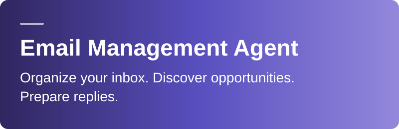

Email Management Agent reduces the work of managing a busy Gmail inbox, with a particular focus on finding and responding to IT architect job opportunities. It helps you spend less time sorting email, extracting job details, and writing initial responses, so you can focus on evaluating worthwhile opportunities.

The application summarizes and categorizes messages across multiple Gmail accounts, applies useful labels, and collects architect job opportunities into a local dashboard. General inbox organization supports this job-search workflow by separating recruitment messages from newsletters, promotions, receipts, and other mail.

## 🔄 Workflow

1. Summarize incoming email and classify it into a supported category.
2. Apply Gmail labels and save architect opportunities with their source email and job details.
3. Review opportunities in the dashboard and select those worth pursuing.
4. Generate recruiter replies and prepare Gmail drafts for your review. The job-response workflow does not send messages automatically.

## 📑 Contents

- [Configuration](#-configuration)
- [Using the application](#-using-the-application)
- [Email processing and storage](#-email-processing-and-storage)
- [Testing and validation](#-testing-and-validation)

## ⚙️ Configuration

### 📧 Gmail accounts and OAuth application

Configure the Gmail accounts in `src/main/resources/application.yml` using a comma-separated list:

```yaml
gmail:
  oauth:
    accounts: first@example.com,second@example.com
```

The supplied configuration also accepts an environment variable:

```bash
export GMAIL_ACCOUNTS='first@example.com,second@example.com'
```

The default account list is `randall.burgess@ultiweb.com,rb@ultiweb.com`. An exported `GMAIL_ACCOUNTS` replaces this list. Use each account's primary Google email address, not a sending alias. Whitespace and duplicate addresses are normalized. `GMAIL_CLIENT_ID` and `GMAIL_CLIENT_SECRET` still configure the shared OAuth application.

### 🔐 Account authorization and token storage

When mailbox access runs, accounts are authorized sequentially. The console identifies the account being authorized and prints `OAuth consent required for Gmail account <email>` before opening a browser when consent is needed. Sign in as that account. The application checks the authorized email and rejects a different account.

Credentials are stored locally under `tokens/`, separately for each email address and permission set. Existing anonymous `user` / `user-*` token entries are left untouched and are not reused: each configured account needs consent on its first access after this change. Subsequent runs reuse its credentials and refresh tokens. Email identity permission is requested alongside Gmail permissions to verify the selected account.

Mail processing visits every configured account. Latest-mail analysis reads up to its requested limit **per account**. Messages and triage results include their owning account so label updates use the correct credentials. Label listing accepts an explicit account; calls without an account require exactly one configured account. Send/draft examples select the configured account matching the sender address.

### 🤖 AI providers and models

The `dev`, `production`, and `local-production` Spring profile groups activate the `litellm` profile. Every inference request — summarization, classification, job-detail extraction, and reply drafting — goes to a single [LiteLLM](https://docs.litellm.ai/) proxy model, `email-router`, through its OpenAI-compatible chat endpoint. Email subject, sender, and normalized visible body text are summarized through the router. HTML mail is converted to bounded plain text while preserving links, lists, image alternative text, and table cell relationships; scripts, styles, hidden elements, tracking query strings, attachments, and markup are excluded. Only the resulting summary is sent for classification; the original email and metadata are not included in that request.

The application reads the router settings from these environment variables:

```bash
export LITELLM_BASE_URL=http://localhost:4000
export LITELLM_API_KEY=sk-your-litellm-key
export LITELLM_MODEL=email-router
```

`LITELLM_BASE_URL` defaults to `http://localhost:4000` (the root of the proxy; the application adds the OpenAI `/v1` path itself), and `LITELLM_MODEL` defaults to `email-router`. `LITELLM_API_KEY` is required; startup fails with a clear message when it is missing. Which upstream models the router selects for each request is configured in LiteLLM, not in this application. These settings live in `src/main/resources/application-litellm.yml`.

### 🔎 Development activity logs

The `dev` profile sets `email.inference.log-prompts=true`, so every LiteLLM call logs the complete user prompt (the email text or summary sent for evaluation) and the raw response, tagged `[summary]` or `[classifier]`. The fixed system prompt is omitted because it is identical on every call. Full email bodies therefore appear in the console; use `production` or set `email.inference.log-prompts=false` to turn it off. Triage also logs each email's subject, sender, generated summary, recommended label, and the label actually applied.

Polling stays off in `dev` by default, so these logs appear when you either set `GMAIL_POLLING_ENABLED=true` or use the dashboard's import action.

### ⏱️ Polling settings

Configure polling in `gmail.polling` or through these environment variables:

```bash
export GMAIL_POLL_INTERVAL=PT5M
export GMAIL_POLLING_ENABLED=true
export GMAIL_INITIAL_LOOKBACK_DAYS=14
```

Use `GMAIL_POLLING_ENABLED=false` to run only the web server. `GMAIL_INITIAL_LOOKBACK_DAYS` accepts 1–365 days and controls the initial catch-up window; the processed Gmail label makes later polls incremental.

### 🔒 Credential security

Do not commit credentials or the local `tokens/` directory.

## 🚀 Using the application

### 🛠️ Development

The safe default profile is `dev`: polling is disabled unless `GMAIL_POLLING_ENABLED=true` is set, inference goes through the LiteLLM `email-router` model, and persistence uses `data/job-search-dev.db`. Set `LITELLM_API_KEY` (and `LITELLM_BASE_URL` when the proxy is not on `http://localhost:4000`) before starting:

```bash
./gradlew bootRun
```

Development runs include Spring Boot DevTools. Java changes take effect after your IDE compiles them (or after running `./gradlew compileJava`); DevTools restarts the application. An open dashboard tab checks the dev-only static asset version and reloads itself when `index.html`, `app.js`, or `app.css` changes.

### 🚀 Production

Production must be selected explicitly. It enables Gmail polling, writes `data/job-search.db`, and activates the LiteLLM router profile:

```bash
SPRING_PROFILES_ACTIVE=production ./gradlew bootRun
```

### 🏠 Production with local database

To run the production workflow with the LiteLLM router, using the local SQLite database:

```bash
SPRING_PROFILES_ACTIVE=local-production ./gradlew bootRun
```

### 🤖 Provider profiles

The `litellm` profile is the only inference profile and supplies the router’s base URL, API key, and model. It does not independently enable production behavior. Every profile uses the same classification categories and prompts. `LITELLM_API_KEY` is required in development and production.

### 📊 Dashboard

The application stays running with an embedded HTTP server on port 8080 and logs startup to the console. Open `http://localhost:8080/` for the job-search dashboard. Set `SERVER_PORT` to change the port; stop the application with Ctrl+C. It loads persisted architect jobs immediately, defaulting to newest first, with options to sort oldest first or by title/company. The detail view includes inferred job information and renders the stored email HTML in a sandboxed frame.

### ✉️ Selecting opportunities and preparing replies

Select opportunities and choose **Save selections & prepare replies**, or prepare one from its detail view. The LiteLLM `email-router` model creates a concise response using the original email and the private Markdown resume in `src/main/resources/resumes`; set `LITELLM_API_KEY` to enable generation. Generated responses, Gmail draft IDs, sent message IDs, thread IDs, and send times are stored in the `responses` table. The detail view can send a prepared reply after confirmation. The `production` profile sends to the recruiter. Every other profile redirects sends to the source mailbox and applies the Gmail label `EMail Agent Test`.

The application checks sent-response threads every hour. At 48 hours after an initial response, if no incoming reply is found, it automatically generates and sends one follow-up in the same Gmail thread. It continues tracking the thread and records when a reply arrives. Non-production follow-ups also go to the source mailbox and receive the `EMail Agent Test` label.

### 📥 Importing opportunities in development

The development dashboard has an explicit import action that summarizes and classifies recent inbox emails and also includes messages already labeled `Architect_Jobs`, stopping after it adds or enriches up to 10 architect opportunities per import. Only architect opportunities are copied into the development database; Gmail labels are not changed and polling remains disabled.

## 📬 Email processing and storage

### ⏱️ Background polling and processing markers

On startup, a background job checks inbox messages from the last 14 days that do not have the internal `Email_Management_Processed` label. It summarizes them locally, sends the summaries to the configured classifier, applies matching convenience labels, and finally applies the processed label. This durable Gmail marker prevents repeat inference after an application restart, including for messages classified as `NONE`. A failure before the processed marker is applied leaves the message eligible for retry. The job starts immediately and waits five minutes after each completed poll before starting another; polls do not overlap. The console logs account checks, inference requests, content lengths, applied labels, skipped messages, and failures without logging complete bodies or summaries.

### 🏷️ Gmail labels

The exact Gmail labels are `Dev_Jobs`, `Architect_Jobs`, `Management_Jobs`, `Misc_Jobs`, `Tech_News_Publications`, `General_News_Publications`, `Promotions_Commercial`, `Receipts`, `Delivery_Notification`, `Security_Alert`, `Personal`, and `Social_Media`. `EmailTag` is the source of truth for these names.

### 🎯 Customizing classification

The classification prompt lives in `src/main/resources/prompts/email-tag-system-prompt.txt`; its required `{{SUPPORTED_LABELS}}` placeholder is expanded from the enum at startup. Set `EMAIL_TAG_SYSTEM_PROMPT_LOCATION` to another Spring resource location such as `file:/path/to/email-tag-prompt.txt` to edit the prompt outside the application, retaining that placeholder. The prompt includes definitions, synthetic examples, and unmatched examples.

### 📋 Classification rules and retries

Job labels require explicit recruitment evidence: `Management_Jobs` covers explicit technology/product delivery management, while other concrete occupations use `Misc_Jobs`. Delivery-only updates and account-security notices have their own labels. `NONE` leaves unsupported, ambiguous, or insufficiently described mail unlabeled. Responses may end with a plain, quoted, Markdown-wrapped, or explicitly prefixed label (for example, `Recommended tag: Receipts`); conflicting labels are rejected. Recommendations are logged as `recommendedLabel` before Gmail writes, including `NONE`. Invalid model outputs fail for retry rather than silently marking an email processed. Existing Gmail labels with older names are not renamed or removed.

### 🗄️ Architect opportunity storage

Only `Architect_Jobs` messages are stored in SQLite. Production uses `data/job-search.db`, which can be overridden with `JOB_SEARCH_DATABASE_URL`, for example `jdbc:sqlite:/absolute/path/job-search.db`; development uses the ignored `data/job-search-dev.db`. Stored positions retain their source account/message identity, subject, sender, received time, classifier summary, and complete normalized visible email text. The `(source_account, source_message_id)` key prevents duplicates, and persistence never deletes existing job, recruiter, or response information. SQLite uses WAL mode and a busy timeout so the dashboard can read while ingestion writes.

### 📥 Manually adding architect opportunities

Manually applying `Architect_Jobs` in Gmail also schedules that message for persistence, regardless of age or its earlier AI classification. The agent searches for `Architect_Jobs` messages without the internal `Architect_Jobs_Persisted` marker, summarizes and stores any missing position, and then applies the persistence and processed markers. Existing database records are retained if labels are later removed or classifications change.

### 🔁 Inference concurrency and retries

Triage runs email inference concurrently on Java 21 virtual threads, preserving result order and serial Gmail writes. Summary and classifier calls share the `email-router` model but keep separate concurrency limits of 8 (`LITELLM_SUMMARY_MAX_CONCURRENT_REQUESTS` and `LITELLM_MAX_CONCURRENT_REQUESTS`, each allowed range 1–200), including time spent retrying. These limits apply per application instance; divide the router or upstream provider budget across instances and other clients. HTTP 429 and transient server failures receive at most two retries with exponential delays starting at two seconds; other client errors are not retried. Failed messages remain eligible for the next poll.

## 🧪 Testing and validation

### 🧪 Isolated checks

The `test` profile disables polling and uses in-memory SQLite. Normal tests explicitly disable real polling or use mocks and in-memory SQLite databases.

Run isolated checks with:

```bash
./gradlew check
```

### 📬 Live Gmail and LiteLLM analysis

To log summaries and labels for up to 50 emails per account:

```bash
RUN_GMAIL_LITELLM_INTEGRATION_TEST=true ./gradlew integrationTest --tests com.ultiweb.jobs.svc.LiteLlmEmailTriageIntegrationTest --rerun-tasks
```

This requires `GMAIL_CLIENT_ID`, `GMAIL_CLIENT_SECRET`, and `LITELLM_API_KEY`, plus a reachable `LITELLM_BASE_URL`. `GMAIL_ACCOUNTS` selects the accounts; `LITELLM_MODEL` overrides the router model. The test disables background polling and analyzes up to 50 latest emails per account. For manual classification review, it logs a bounded subject, generated summary, and recommended label, including `NONE`; it never logs the full body and does not modify messages or labels. It fails if no messages are available or a summary is missing or blank. The opt-in flag enables console output; `--rerun-tasks` ensures Gradle runs it again even if previous test results are up to date. Normal checks skip this live test.

### 🔐 OAuth approval for live integration tests

Integration tests print the OAuth URL for manual approval instead of launching a desktop browser. Open the URL in your browser, sign in as the account shown, and finish consent. The test waits for the localhost callback and then resumes automatically; pressing Enter in the terminal is not required. Cached credentials skip this approval step.

### 🤖 Synthetic classification regression

To evaluate `email-router` classification independently using 27 synthetic regression summaries (all twelve categories, unmatched cases, and an embedded instruction):

```bash
RUN_LITELLM_CLASSIFICATION_INTEGRATION_TEST=true ./gradlew integrationTest --tests com.ultiweb.jobs.svc.ai.LiteLlmClassificationIntegrationTest --rerun-tasks
```

This opt-in test uses `LITELLM_API_KEY` and requires neither Gmail access nor a Gmail account. It makes real classification requests and asserts each expected label; it does not establish accuracy on your mailbox. Normal checks skip it.

### 🔍 SonarQube analysis

SonarQube analysis uses a local SonarQube server at `http://localhost:9000`. With that server running and `SONAR_TOKEN` set in your environment, run `./gradlew sonar`. The task runs unit and integration tests and generates JaCoCo coverage before analysis. For a different self-hosted server address, use `./gradlew sonar -Dsonar.host.url=http://your-server:9000`. The normal `check` task does not run SonarQube analysis.

The `Local SonarQube` GitHub workflow runs on pushes to `develop` and can be started manually on `develop`. It runs `clean check`, connects to the local server over Tailscale, submits analysis, and waits for the quality gate. Community Build supports one analyzed branch per project. We use `develop` as that branch in the existing `email-management-agent` project; this workflow does not analyze `main` or pull requests. Make changes on `develop`, run tests and analysis, review the results, and merge into `main` when satisfied. The existing Build workflow continues to test pushes and pull requests for both `main` and `develop`.

Configure the integration before enabling the workflow in GitHub:

1. Create or confirm the local SonarQube project key `email-management-agent`. Keep the same project key; no second project is needed. Analysis of the `develop` checkout updates this project's single main analysis slot, even if the SonarQube UI labels it `main`. Do not pass `sonar.branch.name` or pull-request parameters to Community Build. Generate a project analysis token and store it in the GitHub Actions repository secret `SONAR_TOKEN`. Use a token from the local server, not SonarQube Cloud.
2. Set the GitHub Actions repository variable `SONAR_HOST_URL` to the Caddy proxy's HTTPS tailnet URL, for example `https://sonar.ultiweb.com` (port 443). The workflow connects through Caddy; ensure the proxy is reachable over Tailscale and forwards requests to SonarQube. `localhost` on a GitHub-hosted runner refers to the runner itself.
3. Create a [Tailscale OAuth client](https://tailscale.com/docs/integrations/github/github-action?tab=oauth+client) with the `auth_keys` **Write** scope and the `tag:sonarqube-ci` tag. The GitHub Action uses this client to create an ephemeral tagged node for the runner. Store the OAuth client ID and secret in the GitHub Actions repository secrets `TS_OAUTH_CLIENT_ID` and `TS_OAUTH_SECRET`. No audience or GitHub federated identity is used. Allow `tag:sonarqube-ci` to reach the Caddy proxy on TCP port 443 using the tailnet's access control policy.
4. In the [SonarQube Cloud project](https://sonarcloud.io/dashboard?id=UltiWebAlt_email-management-agent), disable automatic analysis under **Administration → Analysis Method**. The Cloud GitHub app is independent of this repository's local scanner configuration.

The local server and Tailscale must be online during analysis. No DDNS or public webhook endpoint is needed. Missing integration settings fail the workflow explicitly. After setup, run the workflow manually on `develop` and confirm the analysis appears on the local server before relying on its quality-gate check in branch rules.

### 🛡️ Commit and nightly security checks

OpenGrep runs on branch pushes and pull requests targeting `main` or `develop`. It scans production Java source with a pinned scanner and pinned OpenGrep Java rules, fails on findings or scan errors, and uploads a SARIF report as a workflow artifact.

CodeQL runs nightly at 07:23 UTC for both `main` and `develop`, and on pull requests targeting either branch to satisfy the existing CodeQL protection rules. It can also be started manually. Scheduled workflows must be present on the repository's default branch to run. The schedule is fixed in UTC: 03:23 in New York during daylight saving time and 02:23 during standard time.

The Build workflow continues to run `./gradlew clean check --stacktrace` on pushes and pull requests for both branches. The active `Required Gradle tests` ruleset requires the `Java 21 / Gradle` check from GitHub Actions and an up-to-date branch before accepting updates to `main` or `develop`. These checks gate updates on GitHub; they do not prevent creating local Git commits.
